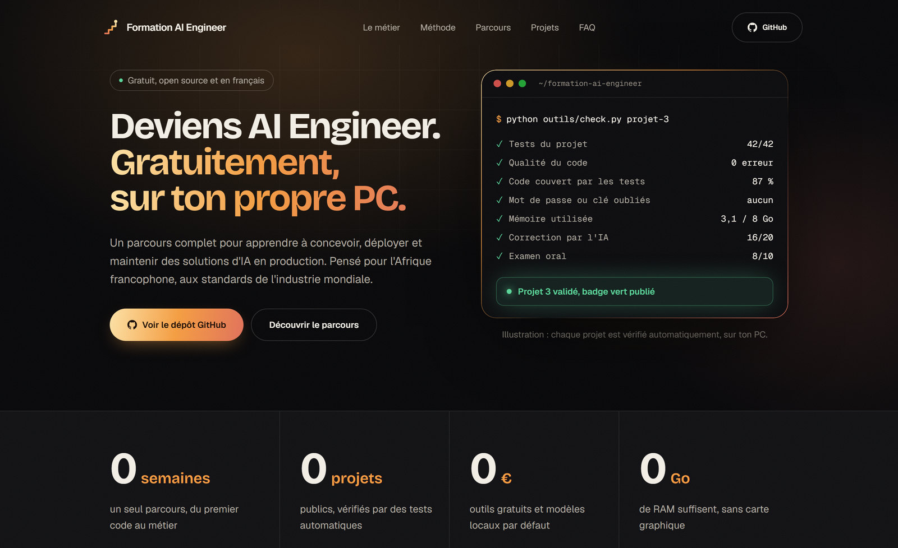
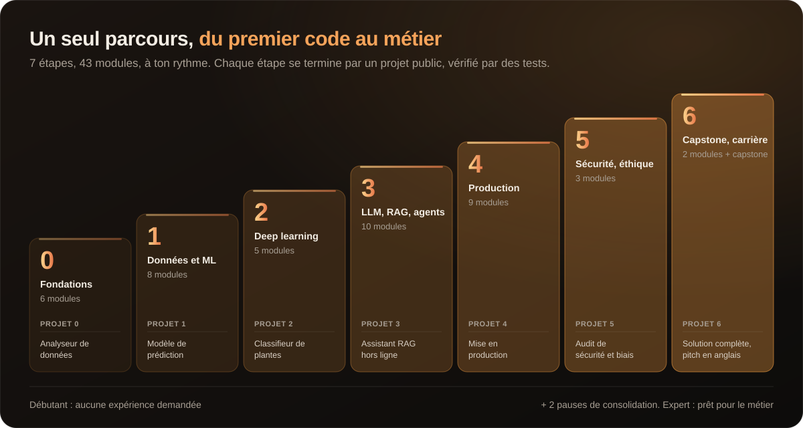
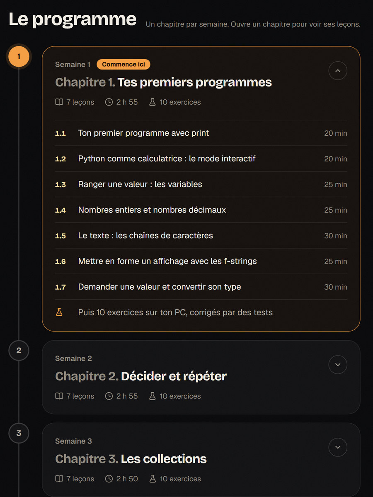

# Formation AI Engineer

Une formation **gratuite et open source** pour devenir AI Engineer, en français. Un seul parcours, du premier code jusqu'au métier : 7 étapes, 72 semaines, 6 projets publics. Tout se fait **sur ton PC**, même modeste : 8 Go de RAM, sans carte graphique, sans rien payer.

<p align="center">
  
</p>

> **État du projet** : en construction. Le programme est fixé, les fiches des modules de l'étape 0 sont écrites, la plateforme web avance. Les cours, exercices et outils de correction ne sont pas encore rédigés. Voir [Où en est le projet](#où-en-est-le-projet).

## Pour qui ?

Pour tout le monde, du débutant motivé qui n'a jamais codé jusqu'au développeur qui veut se spécialiser en IA. Tout le monde suit le même parcours, dans l'ordre.

Tu maîtrises déjà un module ? Passe son QCM (80 % de bonnes réponses) et son exercice clé (tous les tests au vert) sur ton PC. S'ils sont réussis, tu passes au module suivant.

La formation est pensée pour l'Afrique francophone : les exemples et les projets partent de situations réelles (agriculture, santé, mobile money, langues locales), avec les exigences de qualité de l'industrie internationale.

## Le parcours

<p align="center">
  
</p>

| Étape | Thème | Durée | Projet |
| --- | --- | --- | --- |
| 0 | Fondations : préparer son PC, Python, Git, Linux, maths, données | 20 semaines | Un outil en ligne de commande qui analyse un jeu de données public |
| 1 | Développement assisté par IA, données terrain, machine learning classique | 10 semaines | Un modèle de prédiction entraîné en partie sur des données que tu as collectées |
| 2 | Deep learning | 6 semaines | Un classifieur de maladies des plantes, optimisé pour mobile |
| — | Consolidation | 1 semaine | Rattrapage, révisions, projet libre |
| 3 | LLM, RAG, agents, IA locale, langues africaines | 12 semaines | Un assistant RAG sur des documents officiels et un agent avec outils, utilisables hors ligne |
| 4 | Ingénierie de production et pipelines de données | 9 semaines | La mise en production du projet 3 |
| — | Consolidation | 1 semaine | Rattrapage, révisions, projet libre |
| 5 | Sécurité, éthique, IA responsable | 3 semaines | L'audit de sécurité et de biais d'un système existant |
| 6 | Capstone, produit, entrepreneuriat et carrière | 10 semaines | Une solution complète sur un cas réaliste, présentée en anglais en vidéo |

Compte environ 15 h par semaine : 3 h de cours, 9 h de pratique, le reste pour les QCM et la vérification. C'est indicatif, chacun avance à sa vitesse.

Le détail de chaque module est dans [docs/programme.md](docs/programme.md).

## Comment ça marche

Tu clones ce dépôt une fois, puis tu travailles en local. La connexion ne sert qu'à télécharger les mises à jour, les jeux de données et les modèles.

1. **Tu lis le cours** d'un module, sur le site de la formation ou directement dans les fichiers du dépôt.
2. **Tu fais les exercices** sur ton PC. Des tests automatiques les corrigent, et chaque exercice a des indices à dévoiler un par un.
3. **Tu passes le QCM** du module dans ton terminal.
4. **À la fin de chaque étape, tu réalises un projet.** Il est validé par ses tests, des contrôles de qualité, un badge vert sur GitHub, puis un examen oral mené par un agent IA qui vérifie que tu comprends ton code.

<p align="center">
  
  <br>
  <sub>Le programme d'un module sur le site : un chapitre par semaine, des leçons de 15 à 30 minutes.</sub>
</p>

Il n'y a ni compte, ni inscription, ni mentor, ni diplôme. Ta preuve de niveau, c'est ton **portfolio GitHub** : 6 projets publics dont les tests passent, vérifiables par un recruteur en quelques minutes.

## Matériel minimum

| Élément | Minimum | Confortable |
| --- | --- | --- |
| Processeur | 64 bits, 4 cœurs | 8 cœurs |
| Mémoire vive | 8 Go (4 Go suffisent pour les étapes 0 et 1) | 16 Go |
| Disque libre | 40 Go | 100 Go, en SSD |
| Carte graphique | Aucune | Aucune nécessaire |
| Système | Linux, Windows (avec WSL) ou macOS | Linux |

Tous les outils sont gratuits. Quand une API payante apporte vraiment quelque chose, la formation recommande la moins chère et propose toujours une alternative locale gratuite.

## Démarrer

```bash
git clone https://github.com/DelRoos/ai-engineering.git
cd ai-engineering
```

Commence ensuite par le module **0.0 Préparer son PC** ([fiche](00-fondations/00-preparer-son-pc/fiche.md)) : il installe Python, Git et VS Code, et vérifie que tout fonctionne.

## Où en est le projet

- [x] Programme complet ([docs/programme.md](docs/programme.md))
- [x] Guide pédagogique, format du contenu, glossaire et modèles de fichiers
- [x] Fiches des modules de l'étape 0 : objectifs, chapitres et leçons (en attente de validation)
- [x] Plateforme web : page d'accueil, liste des modules, page de chaque module
- [ ] Cours, exercices et QCM de l'étape 0
- [ ] Outils de l'apprenant : `check.py`, `qcm.py`, `progression.py`
- [ ] Agent correcteur et examen oral avec l'IA
- [ ] Étapes 1 à 6

## Organisation du dépôt

```
ai-engineering/
├── docs/              # programme, guide pédagogique, format du contenu, glossaire, images
├── templates/         # modèles à copier : fiche, cours, exercice, QCM, projet
├── 00-fondations/     # étape 0 : un dossier par module (fiche, cours, exercices, QCM)
├── 01-ml/ … 06-capstone/
├── outils/            # outils de l'apprenant : correction, QCM, progression
└── plateforme/        # le site web de la formation (Next.js)
```

## Le site de la formation

Le site affiche les cours à partir des fichiers du dépôt. Tu n'en as **pas besoin** pour suivre la formation : tout est lisible directement ici. Pour le lancer sur ton PC (Node.js 20 ou plus récent) :

```bash
cd plateforme
npm install
npm run dev    # http://localhost:3000
```

Détails techniques dans [plateforme/README.md](plateforme/README.md).

## Contribuer

Les contributions sont les bienvenues : corrections, relectures, exercices, traductions.

- Lis d'abord [AGENTS.md](AGENTS.md) : les règles d'écriture et le circuit de production d'un module, de la fiche à la relecture.
- Le [guide pédagogique](docs/guide-pedagogique.md) explique comment écrire un cours, un exercice et un QCM.
- Le [format du contenu](docs/format-contenu.md) décrit les fichiers que la plateforme sait lire.
- Pour une erreur ou une idée, ouvre une issue.

## Licences

- Contenus pédagogiques : [CC BY-SA 4.0](https://creativecommons.org/licenses/by-sa/4.0/deed.fr)
- Code : [MIT](https://opensource.org/license/mit)
